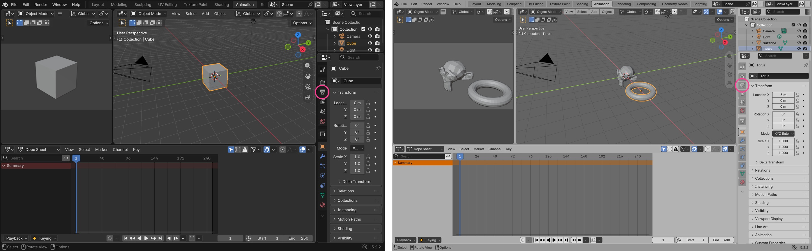

# Show Me Once: evidence

Everything here came from running the code on 2026-11-01, on an M5 Pro MacBook (1512x982 points), macOS 26.6.2, with `claude-sonnet-5-5` through the logged-in claude CLI.

**Nothing here is a live lesson.** No part has run in Numbers or on a real teaching take, because Screen Recording, Accessibility and Microphone aren't granted. The example lesson is synthetic, and it says so on its own share card.

## How the synthetic test works

`scripts/make-synthetic-lesson.py` stands in for a person:

| Part | Real or synthetic |
|---|---|
| Window images | Real: Blender's export of its own window, needing no permission. Each frame's content is read back by OCR before use. |
| The changes between frames | Synthetic: a script made them, not a person clicking |
| Narration audio | Synthetic: written by hand, spoken by `say` |
| Transcript | Real: that audio through teach mode's own recognition code, on-device (runs 6 to 8). Runs 1 to 5 used the written text. |
| Accessibility info | Absent: Blender exposes none, so every step here went through vision |
| Compiling, locating, checking, costs | Real model calls |
| Capture path | Fixture: saved images placed where the window server says the window is. **ScreenCaptureKit was not exercised.** |

Teacher: dark theme, 1100x720 window, default cube, 250 frames.
Follower: light theme, 1400x840 window, Suzanne and a torus, 480 frames.

Left is where the teacher clicked, right is where follow mode pointed on the different setup. Steps [1](images/adaptation-step-1.jpg) and [3](images/adaptation-step-3.jpg) are alongside it.

## Results

8 runs of 4 steps, each a fresh compile and a fresh follow. See [`runs/`](runs/).

| Check | Result |
|---|---|
| Step counted done after the real action | 32 of 32 |
| Not counted done before the action | 32 of 32 |
| Not counted done after a different change | 32 of 32 |
| Pointing, targets with words | 24 of 24 |
| Pointing, the wordless printer icon | **6 of 8** |
| Lessons compiled | 8 of 8, 4 steps each |
| Spoken lines kept as the teacher's words | 32 of 32, word overlap 0.92 to 1 |

Ground truth doesn't come from the model. Words use Vision OCR. The icon uses the rows where Blender's own tab highlight moved, which gives a 28pt-tall target.

**The two misses** (runs 1 and 7) were both one tab too high, on the camera icon just above the printer. It's a real limit on small, wordless, look-alike targets. In a live lesson the teacher's line still names the printer. Numbers' toolbar buttons have text labels, but that's untested.

Runs 1 and 7 report `verification_failed` because of those misses. They weren't rerun or dropped.

**What didn't pass at first.** The [first valid run](logs/first-valid-run-with-step-3-failure.log) scored 3 of 4, and isn't in the table above because the check design changed after it:

- Step 3's success check failed. "A new, shorter value" can't be judged from one screenshot, so checks now compare the screen from when the step began with the current one.
- Step 3's pointing was marked a miss, wrongly: it was on the right field, and the ground truth was the label beside it. The ground truth was changed to the follower's value, `480`.

Earlier runs on stale Blender frames were thrown away, and frames are now validated first.

## Cost

All figures are estimates: the claude CLI's own list-price calculation, not a billed amount. A logged-in subscription may not be charged per token.

| What | Estimated cost, 8 runs |
|---|---|
| Replaying this 4-step lesson | median $0.054, range $0.044 to $0.065 |
| Compiling it | $0.011 to $0.036 |
| One follower question | $0.010 to $0.019 |

Replay figures cover what a follower would pay for: 4 locates plus the checks that needed the model. Control calls are excluded, and reported separately in each run. Local OCR settled 18 of 32 checks at no cost. With no accessibility info, this is the expensive case: named app controls found through accessibility cost nothing to locate, which is untested on a real app.

Compile took 12.6 to 19.8 seconds.

## Other checks

| Check | Result | File |
|---|---|---|
| Lesson self-test | 84 checks pass: keystroke privacy, secure input, file safety with real crafted archives, cost rules, a real password field through the accessibility reader, and audio from a background thread | [`logs/lesson-self-test.json`](logs/lesson-self-test.json) |
| Foundation self-test | 25 checks pass | [`logs/foundation-self-test.json`](logs/foundation-self-test.json) |
| Teach mode's recognition on spoken audio | On-device, no errors, 13 phrases from 31.7 seconds | [`logs/narration-recognition.json`](logs/narration-recognition.json) |
| Question the teacher answered | Gave the teacher's reason, credited by name | [`logs/question-1.json`](logs/question-1.json) |
| Question the teacher didn't cover | Said so, then answered from elsewhere | [`logs/question-2.json`](logs/question-2.json) |
| Cursor holds at a target for 7 seconds, repeats, releases | Passed, from the overlay's state. No pixels were seen. | [`logs/cursor-hold-and-voice-clips.json`](logs/cursor-hold-and-voice-clips.json) |
| Voice clips | All 6 load in the player. Nobody listened to them. | same file |
| Opening a lesson while the app wasn't running, capture blocked | The file arrived, it failed at once, and it spoke the fix | [`logs/opening-a-lesson-with-capture-blocked.log`](logs/opening-a-lesson-with-capture-blocked.log) |
| Numbers opens the demo CSV | 0 windows before, 1 after, from window bounds only. Its contents weren't seen. | [`logs/numbers-opens-demo-csv.log`](logs/numbers-opens-demo-csv.log) |
| Demo script with permissions missing | Names what's missing, exits 3 | [`logs/demo-script-preflight.log`](logs/demo-script-preflight.log) |

## Images

These are rendered by the app's own views, so they need no screen capture.

- [`images/share-card.png`](images/share-card.png): the card, with its synthetic warning
- [`images/indicator-watching.png`](images/indicator-watching.png) and [`images/indicator-password.png`](images/indicator-password.png): the pill
- [`images/panel-section.png`](images/panel-section.png): the panel section

## Example lesson

[`example-lesson/synthetic-blender-lesson.clicky`](example-lesson/synthetic-blender-lesson.clicky) is from run 8, and [`lesson.json`](example-lesson/lesson.json) is its manifest. The voice in it is `say`, not a person. It has only recognizer output to work with, so it carries that output's mistakes, like "five seconds of 24 frames".

Step 3's reference crop shows the timeline's End field rather than the properties one, because the script placed that synthetic click on the first "End" that OCR found.

## Not verified

**Needs permissions:**

- Teach mode live: the event tap, the mic, frames around real clicks, the hot key, and the indicator on screen
- Follow mode live: the loop, the screen-change trigger on real capture, and voice clips playing
- A follower question through push-to-talk
- Anything in Numbers: its layout, how it imports CSV, what its accessibility tree reports
- Finding app controls through accessibility in another app
- ScreenCaptureKit itself

**Broken or unresolved:**

- `--headless-transcribe`, from the foundation, hung for 5 minutes on a spoken file with Speech Recognition granted, and was killed. Teach mode's own path worked on the same recognizer. Live push-to-talk uses that older provider, so test a question early.
- Double-clicking a `.clicky` file doesn't resolve to any app on this Mac. The type is registered and claimed correctly, but 6 copies of Clicky share the bundle id, and that's the likely cause, not a proven one. The panel, `open -a` and `--follow` all work around it, and the script warns.
